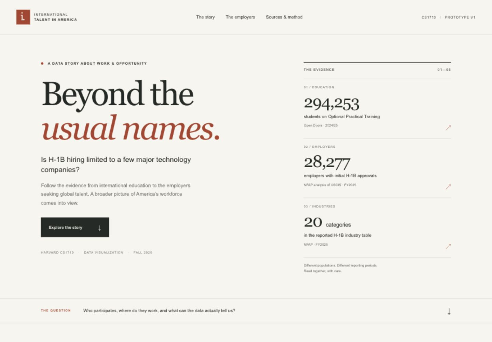
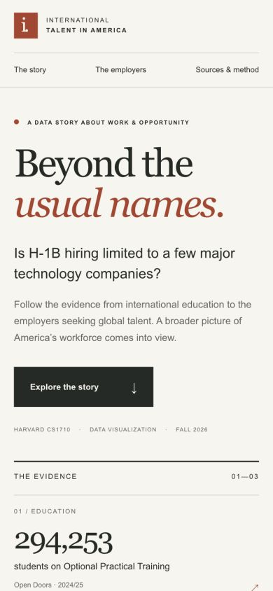
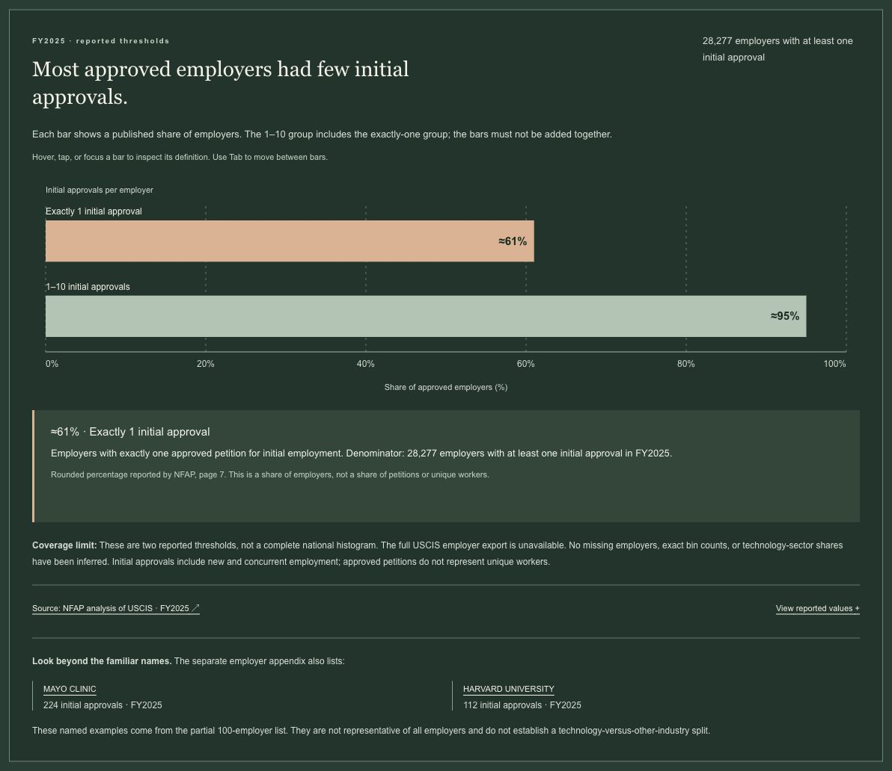
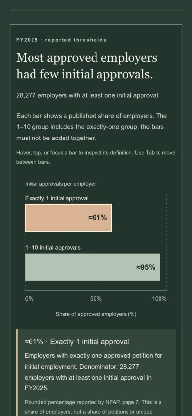
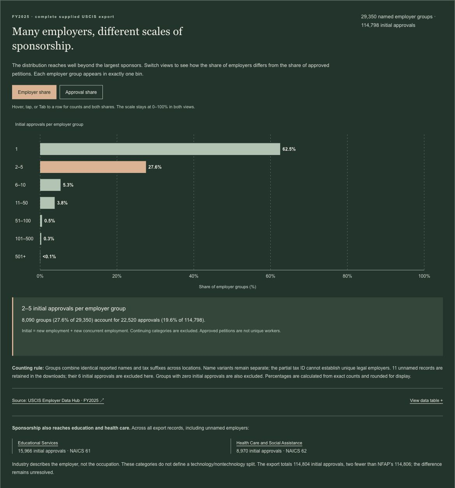
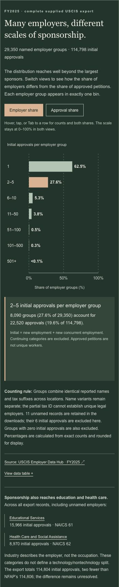

# Prototype verification

**Current status:** the FY2025 export integration supersedes earlier missing-USCIS limitations below. Prior sections are a historical verification log; see the final section for current checks.

Verification date: October 25, 2026 (America/New_York).

## Foundation checks (prior phase)

- Source retrieval: three Open Doors XLSX files, one NFAP PDF, and one Fru HTML reference downloaded. Seven additional requests failed with HTTP 403; details are retained in the manifest.
- Original checksums verified before cleaning. PDF pages 24 and 27 visually inspected to confirm employer-name wrapping and industry table extraction.
- All eight processed CSVs are nonempty, have consistent headers, and have unique analytical keys. Counts are nonnegative integers. Source file and row/page coordinates are retained.
- Cross-workbook OPT reconciliation checked, preserving the documented 1994/95 discrepancy. NFAP industry total discrepancy recorded rather than “fixed.”
- Offline pipeline rerun produced byte-identical SHA-256 hashes for all ten processed files (eight CSVs and two JSON files).
- `python -m unittest discover -s tests -v`: **7 tests passed**. Negative tests reject duplicate keys, negative counts, a truncated employer table, and changed OPT records.
- `npm run build`: **passed**, using React 19.3.1, Vite 8.3.5, and D3 7.9.0. `npm install` reported no dependency vulnerabilities at installation time.
- Local preview returned HTTP 200. Browser console inspection captured no warning/error messages during the tested interactions.
- OPT selector changed to the full history; data table showed all 46 years, from 2,840 in 1979/80 to 294,253 in 2024/25.
- Employer search for `Harvard` returned `HARVARD UNIVERSITY`, 112 initial approvals, FY2025. Full table coverage remains explicitly limited.
- Industry expansion displayed all 20 reported rows.
- All eight CSV download endpoints returned byte-for-byte copies of their processed originals, with the expected row counts.
- Desktop 1440 × 1000 and mobile 390 × 844 viewports inspected. Document width equaled viewport width at both sizes. Mobile hero typography measured 56 px, chart container 322 px.
- Additional 320-pixel and 768-pixel viewport checks found no horizontal document overflow. Temporary viewport overrides were reset after testing.
- Mobile chart uses an observed 322-pixel viewBox width and 11-pixel axis labels, preserving legibility instead of shrinking a desktop SVG.

## Review images

## Limits

This is a focused browser smoke test, not a comprehensive cross-browser or assistive-technology audit. Keyboard-operable native controls, visible focus styles, a skip link, semantic headings, chart description, and an alternate data table are included. Two standard D3 visualizations are implemented: the OPT line chart and the limited H-1B reported-threshold bar chart. Placeholders and HTML tables are not counted as charts; the exact national employer histogram remains unavailable.

No claim is made that blocked datasets, complete employer microdata, matched wage comparisons, a process-book PDF, a novel design, or a final ZIP have been delivered. See the exact status tracker in `prototype-v1.md`.

## Second D3 visualization checks

Verified October 25, 2026, after inspecting all eight CSVs and source documentation. See `data-audit.md` for the complete file-by-file report.

- Every CSV was regenerated in memory from its original XLSX/PDF. Byte-for-byte comparisons passed for all eight; raw and processed files were preserved.
- Seven Python pipeline tests passed again. Seven additional Node tests (`npm run test:charts`) passed: real source values, order independence, missing/duplicate records, incompatible periods/populations/units, invalid values, provenance, and common 0–100% scales.
- Production build (`npm run build`) passed with no new dependencies.
- The H-1B view loads `h1b_employer_distribution.csv` through D3 `csvParse`. Two bars encode exactly the published rounded 61% and 95% records; no inferred bins, complementary shares, or estimated employer counts are generated.
- At a 1,106-pixel SVG width, the common plot width was 1,070 pixels. Actual rendered bar widths were 652.7 and 1,016.5 pixels, matching 61% and 95%. Both bars start at the same zero baseline.
- Clicking a bar and tabbing between bars updates the selected state and definition panel. The 95% selection explicitly says it includes the exactly-one group. Enter/Space handlers support activation; pointer entry uses the same selection handler.
- Source-value table expands to two records (61%, 95%). Source attribution links to NFAP page 7. The employer examples link to their original appendix pages and retain the source counts (Mayo Clinic 224; Harvard University 112).
- Desktop (1280 px) and mobile (390 px) checked. On mobile the chart is 324 pixels wide with a 324 × 290 viewBox; labels remain readable and document width matches the viewport.
- Additional checks at 320 px (254-pixel chart) and 768 px found no document overflow. Viewport overrides were restored afterward; the existing preview server was left running.
- OPT regression: full-history selector renders 46 points and 46 table rows; final row remains 2024/25, 294,253 students. Existing `OptChart.jsx` was not edited.
- Browser console inspection captured no warning/error entries during these interactions.

This verifies a **reported-threshold summary**, not a complete national histogram or a technology/nontechnology distribution. The original USCIS employer records remain missing. Hover behavior is implemented via pointer entry; the focused smoke test exercised pointer clicks, keyboard focus, and responsive rendering, not a full automated cross-browser event suite.

## Complete supplied FY2025 export integration

- Located `Employer Information (1).csv` in Downloads and copied it to `data/raw/` byte-for-byte. SHA-256 matches the original and the manifest. No raw file was rewritten. Original retrieval time is unknown; ingestion time is recorded separately.
- Parsed all 62,415 UTF-16/tab records. Verified every FY2025 line ID, 12 category counts, new/concurrent separation, and conservation through employer and industry aggregation.
- Produced five additional CSVs (62,415 records; 55,142 employer groups; seven bins; 21 industry rows; 21 comparison rows) and the reconciliation JSON. Independent tests compare every group and industry with raw CSV sums and every output byte with a fresh derivation.
- An offline rerun regenerated all sixteen processed artifacts (thirteen CSVs and three JSON files) byte-for-byte. Sixteen Python tests and seven Node chart tests pass. Negative cases cover malformed encodings/headers, mixed years, duplicate line IDs, missing counts, invalid comma formatting, changed manifest originals, missing/overlapping bins, lost provenance, and mismatched percentages or denominators.
- The production build passes. A separate production preview verified seven marks and successful approval-share switching, with no captured console errors/warnings. All thirteen actual download URLs (including inline small CSVs) returned bytes identical to their processed originals. The temporary production server/tab were closed; the existing development server was preserved. Large record/employer CSVs are download assets, not embedded in the JavaScript data parser. No dependency changes were needed.
- Browser checks verified seven bins, source-based labels, employer/approval-share switching, row click and keyboard focus, and the seven-row alternate data table. The 501+ group reads 12 named groups, 12,510 approvals, <0.1% of groups and 10.9% of named-group approvals. Pointer-entry handling uses the same selection function; no separate automated hover test is claimed.
- At desktop 1280 px the SVG is 1,106 px wide with a 986 px plot range. Bar widths in approval mode match the processed approval shares. Mobile 390 px uses a 324 × 440 SVG and readable labels; no horizontal page overflow.
- A 320 px check exposed overflow in the updated decimal headline. A scoped H-1B-only rule stacks that headline and description below 380 px; the shared stylesheet and unrelated components are unchanged. Rechecking at 320 px confirmed document width 320 px, including with the data table open; the table scrolls inside its 254 px container. The 768 px check also had no document overflow, and viewport overrides were reset.
- OPT regression verified all 46 full-history table rows and final 2024/25 value 294,253. All original eight processed CSVs, `OptChart.jsx`, `EmployerTable.jsx`, and `src/styles.css` match their pre-import hashes.
- Browser console captured no warning/error entries during the tested interactions. This is a focused browser smoke test, not a comprehensive accessibility or cross-browser certification.

Reconciliation remains explicit: initial approvals −2 versus NFAP, continuing +1; reported industries −10 plus 2,215 observed approvals with missing industry. No source records were changed to force agreement. Identity groups are not verified unique legal employers. See `uscis-fy2025-reconciliation.md`. No commit or push was made.

## ICE calendar-2024 employer pipeline integration

- Preserved the supplied four-page PDF byte-for-byte; original and archived SHA-256 both equal `e4e306a6ce75e347a2bc87b88403f5cb1eadc2707b6880c04faf259688860f3f`. Recorded canonical ICE URL, source-URL metadata evidence, calendar-year period, byte length and import timestamp. Actual download date remains pending confirmation; PDF creation/modification dates were not substituted.
- Rendered and visually inspected all four source pages. Extracted 200 employers, with 58/63/63/16 page coverage. Grid and text extraction agree for every row; tests compare all 200 names and 600 numeric cells to PDF table positions.
- Visually verified Amazon, Google, Microsoft, Meta and Apple controls on page 1. Eleven STEM OPT blanks are preserved as missing; no explicit zeros were printed. Combined totals remain independently reported values rather than OPT-plus-STEM sums.
- The visibly clipped page-4 label `AMERICAN TECHNOLOGY CONSULTING L` is preserved, annotated and excluded from matching. No rows were lost or inferred.
- Conservative matching yields 47 accepted name-level comparisons, 14 ambiguous full-name cases, 97 unresolved variants, 41 with no candidate and one clipped label. All 200 decisions and 455 lexical candidates are published separately. Test fixtures demonstrate that zero-approval competing groups, missing tax suffixes, duplicate ICE names and possible prefix-scope conflicts block automatic joins.
- `python -m unittest discover -s tests -v`: **28 tests passed** (12 new ICE tests plus 16 previous tests). `npm run test:charts`: **7 tests passed**. `npm run build`: **passed**. Python verification used the bundled runtime with the pinned project dependencies.
- Full offline pipeline rerun produced byte-identical hashes for **all 21 processed artifacts** (17 CSVs and four JSON reports). No network download was needed. Downloader refresh tests verify manual-source preservation and historical alias retention without making network requests.
- Every existing `src/` file and all 13 previous CSVs retain their pre-integration SHA-256 values. No visualization or website source was edited. The existing CSV-download glob and validation display incorporate the new metadata automatically; old placeholder/source-card text is intentionally deferred to the next UI phase. No new browser/UI behavior is claimed from this data-only verification.
- The accepted output compares employer-level CY2024 participation with FY2025 petition approvals, using explicit periods, source pages and USCIS source-line references. It contains no conversion-rate or person-transition fields. The periods overlap in October–December 2024 and do not identify a student cohort.

See `ice-2024-employers.md` for complete schemas, source controls, all ambiguous full-name cases and the matching limitations. No commit or push was made.
